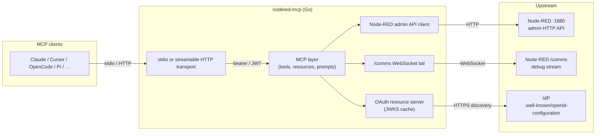
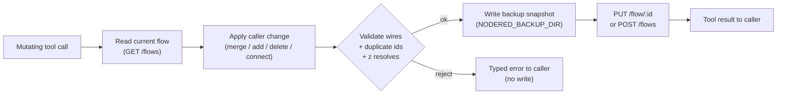

# Arquitectura

[English](../architecture.md) | **Español**

Esta página explica cómo está construido `nodered-mcp` por dentro: con qué
habla, cómo protege tus flujos antes de modificarlos y por qué se diseñó así.
Está escrita para quienes contribuyen y para operadores que quieren entender
qué hace el servidor entre bastidores; no la necesitas para usar el servidor.
Si solo quieres saber qué puedes pedir, lee mejor [Herramientas](tools.md).

`nodered-mcp` es un único binario que traduce las peticiones MCP en llamadas a
la [API de administración](glossary.md#api-de-administración) de Node-RED. La
capa MCP es deliberadamente delgada: cada método del cliente corresponde
exactamente a un endpoint de administración; la capa MCP decide cómo exponer
esas operaciones como [herramientas](glossary.md#herramienta-tool).

## Contenido

- [Flujo de datos](#flujo-de-datos)
- [Proceso de edición](#proceso-de-edición)
- [Tiempos límite y reintentos de las herramientas](#tiempos-límite-y-reintentos-de-las-herramientas)
- [Árbol de código fuente](#árbol-de-código-fuente)
- [Dependencias](#dependencias)
- [Decisión de diseño: los flujos son JSON opaco](#decisión-de-diseño-los-flujos-son-json-opaco)
- [Seguridad: política de tipos de nodo en cada escritura (issue #329)](#seguridad-política-de-tipos-de-nodo-en-cada-escritura-issue-329)
- [Ciclo de vida del ayudante de contexto](#ciclo-de-vida-del-ayudante-de-contexto)
- [Seguridad: copia de seguridad antes de las escrituras de configuración de flujos (garantía de v0.1)](#seguridad-copia-de-seguridad-antes-de-las-escrituras-de-configuración-de-flujos-garantía-de-v01)
- [Verificación de las afirmaciones](#verificación-de-las-afirmaciones)
- [Hallazgos que costaron tiempo](#hallazgos-que-costaron-tiempo)

Términos como [flujo](glossary.md#flujo-flow), [nodo](glossary.md#nodo),
[contexto](glossary.md#contexto) y
[copia de seguridad](glossary.md#copia-de-seguridad-backup) se explican en el
[glosario](glossary.md).

## Flujo de datos

En palabras sencillas: tu cliente de IA habla con `nodered-mcp` (por stdio o
HTTP), y `nodered-mcp` habla con Node-RED en tu nombre.

La forma de extremo a extremo, incluida la ruta de descubrimiento de OAuth que
la versión ASCII perdía por la indentación:



## Proceso de edición

En palabras sencillas: antes de enviar un cambio a Node-RED, el servidor lee la
configuración actual, aplica el cambio, comprueba el resultado y guarda una
[copia de seguridad](glossary.md#copia-de-seguridad-backup). Si la comprobación
falla, no se envía nada.

Las herramientas que modifican siguen una ruta de lectura, modificación y
escritura con tres guardas antes de que un solo byte llegue al runtime.
Diagrama opcional para operadores que depuran una escritura de flujo que fue
rechazada:



## Tiempos límite y reintentos de las herramientas

El envoltorio de registro da a cada intento de herramienta un plazo de contexto
(context deadline). El valor por defecto es de 15 segundos; las herramientas
cuyo trabajo legítimamente dura más tienen su propio presupuesto: las
operaciones de paleta (`install_node`, `uninstall_node`) tienen cinco minutos,
porque npm se ejecuta por debajo, y las escrituras de despliegue completo y de
estado del runtime (`set_flows`, `set_flows_state`, `restore_backup`) tienen
dos minutos, porque un despliegue completo o un reinicio del runtime puede
bloquear una instancia ocupada. El plazo que fija el envoltorio es el *padre*
del plazo del propio cliente, y un contexto hijo no puede extender a su padre,
así que el envoltorio tiene que conceder al menos lo que pide el cliente; de lo
contrario, el presupuesto del cliente nunca tendría efecto.

Solo las herramientas de lectura reintentan los fallos de transporte, hasta un
total de tres intentos. El cliente HTTP marca los intercambios fallidos con
`TransportError`; los adaptadores MCP conservan esa cadena de errores hasta que
el envoltorio elige una política de reintentos. Un texto como `EOF` nunca
determina si una operación se reintenta. Los errores HTTP completos y los
errores de validación local mantienen sus respuestas de error de herramienta
existentes.

Los manejadores que modifican nunca se repiten automáticamente. Un fallo de
transporte devuelve un resultado de error de herramienta que indica que el
resultado es indeterminado y que quien llama debe inspeccionar el runtime antes
de repetir la operación. Perder una respuesta no deshace la acción. Las guardas
de copia de seguridad antes de escribir y de bloqueo de escritura siguen
vigentes, pero no pueden deshacer mensajes del runtime ni comandos enviados a
hardware. Un cliente que cancela una llamada aborta la petición al runtime, y
el runtime aún puede estar trabajando en la operación que el cliente
abandonó; por eso una operación cancelada tampoco se repite nunca.

## Árbol de código fuente

```
nodered-mcp/
├── cmd/nodered-mcp/
│   ├── main.go         # entrypoint; subcommands serve / init / version
│   ├── init.go         # client detection and MCP config writer
│   └── update.go       # in-place upgrade detection
├── internal/
│   ├── config/
│   │   ├── config.go       # env-var + flag loader
│   │   └── httpauth.go     # bearer + OAuth wiring
│   ├── nodered/
│   │   ├── client.go       # HTTP client + auth
│   │   ├── flows.go        # flow CRUD (JSON-opaque)
│   │   ├── edit.go         # granular node editing
│   │   ├── inspect.go      # flow summary and search
│   │   ├── diff.go         # configuration comparison
│   │   ├── nodes.go        # palette: install / uninstall / enable / disable
│   │   ├── settings.go     # settings, runtime state, npm search
│   │   ├── runtime.go      # diagnostics, context, plugins
│   │   ├── comms.go        # /comms WebSocket tail
│   │   ├── backup.go       # snapshot before write
│   │   ├── status.go       # node-status cache from /comms
│   │   ├── logs.go         # /logs client
│   │   ├── subflows.go     # subflow CRUD
│   │   ├── policy.go       # node-type policy: walk + enforcement point
│   │   ├── validate.go     # local structural validation
│   │   └── types.go        # minimal types + RawFlow
│   ├── mcp/
│   │   ├── server.go       # stdio + streamable HTTP transports
│   │   ├── tools.go        # tool registration table
│   │   ├── tools_flows.go  # flow-handler implementations
│   │   ├── tools_nodes.go  # palette handlers
│   │   ├── tools_subflows.go
│   │   ├── tools_context.go
│   │   ├── tools_runtime.go
│   │   ├── tools_settings.go
│   │   ├── tools_backups.go
│   │   ├── tools_shared.go
│   │   ├── denylist.go     # policy content + canonical refusal wording
│   │   ├── resources.go    # 3 resources
│   │   ├── prompts.go      # 2 prompts
│   │   ├── httpauth.go     # bearer + OAuth middleware
│   │   ├── http_observe.go
│   │   ├── http_ratelimit.go
│   │   └── clipboard.go
│   └── oauth/
│       ├── discovery.go    # /.well-known/openid-configuration
│       ├── jwks.go         # JWKS cache + verification
│       ├── verifier.go     # token verification
│       └── middleware.go   # authorization middleware
└── examples/
    ├── claude_desktop_config.json
    ├── cursor_mcp.json
    ├── gemini_settings.json
    ├── vscode_mcp.json
    ├── opencode_config.json
    └── pi_mcp_config.json
```

Puedes regenerar este árbol con:

```bash
find cmd internal -name '*.go' ! -name '*_test.go' | sort
```

Cualquier `.go` que no figure aquí es una desviación (drift); cualquier ruta
listada aquí que no exista en disco también lo es.

## Dependencias

| Componente | Elección |
|---|---|
| Lenguaje | Go 1.25+ |
| SDK de MCP | [`mark3labs/mcp-go`](https://github.com/mark3labs/mcp-go) — stdio y streamable HTTP |
| Cliente HTTP | `net/http` (biblioteca estándar) |
| WebSocket | [`coder/websocket`](https://github.com/coder/websocket) — el stream de depuración `/comms`, sin dependencias transitivas |
| JWT | [`golang-jwt/jwt/v5`](https://github.com/golang-jwt/jwt) — verificación de tokens OAuth |
| Registro de logs | `log/slog` (biblioteca estándar) |
| Configuración de desarrollo | [`godotenv`](https://github.com/joho/godotenv) |

Sin frameworks, sin ORM, sin cliente de Node-RED de terceros.

## Decisión de diseño: los flujos son JSON opaco

`RawFlow` está tipado como `json.RawMessage`:

```go
// internal/nodered/types.go
type RawFlow = json.RawMessage
```

Node-RED es deliberadamente libre de esquema: cada tipo de nodo tiene su propia
forma. Modelar los nodos con structs fijos de Go descartaría en silencio todos
los campos no reconocidos en un ciclo de lectura y escritura. `nodered-mcp`
pasa el JSON del flujo tal cual y solo analiza los campos concretos que
necesita, donde los necesita. Nunca se pierde ningún campo.

**Reglas:**

- Los flujos y los nodos se manejan como **JSON opaco**. Cero pérdida de campos.
- Solo se analizan los campos concretos que hacen falta en el punto de uso
  (por ejemplo, extraer `id` / `type` / `label` para un resumen legible).
- El servidor nunca reescribe un nodo que no entiende: lo pasa tal cual.
- Cuidado con lo que un LLM edita a ciegas: `wires`
  (`[[out1, out2], …]`), los IDs, los nodos de configuración compartidos y las
  credenciales (un canal aparte).
- **Hallazgo que costó tiempo:** `GET /flow/:id` **no** devuelve un único
  array. Divide el contenido de la pestaña en `nodes` y `configs`, con la regla
  de `runtime/lib/flows/util.js`: un objeto con coordenadas de lienzo `x`/`y`
  va a `nodes`, cualquier otro a `configs`. Un broker MQTT compartido vive en
  `configs` aunque pertenezca a la pestaña. Las herramientas de edición
  granular respetan esa división; ignorarla hacía desaparecer nodos del
  lienzo.
- **Trampa de lectura para quien se incorpora:** `grep Extra internal/nodered/`
  encuentra `internal/nodered/edit.go`. **Ese no es el bug de v0.1.**
  El bug original era un campo de struct con una etiqueta `json:"-"` que
  `encoding/json` descarta por completo. El actual
  `Extra map[string]json.RawMessage` existe precisamente para conservar los
  campos desconocidos de la pestaña en el ciclo de lectura y escritura. La
  presencia del campo es la cura, no la enfermedad.
- **Estrategia de edición:** ambas, con las granulares por defecto
  (`add_node`, `update_node`, `delete_node`, `connect_nodes`) y
  `update_flow` como vía de escape para reescrituras completas. `update_node`
  **combina** propiedades en lugar de reemplazarlas; `delete_node` limpia los
  cables entrantes; `connect_nodes` añade al puerto indicado y amplía el array
  `wires` cuando ese puerto todavía no existe.

## Seguridad: política de tipos de nodo en cada escritura (issue #329)

`MCP_NODE_DENYLIST` (por defecto `exec,system`) es una política sobre tipos de
nodo (la [lista de bloqueo](glossary.md#lista-de-bloqueo-denylist)). Pertenece
a la capa MCP, que es dueña de la redacción dirigida al operador, y la aplica
el cliente `nodered`, que es la única capa que conoce la **configuración
efectiva** que desplegaría una escritura.

- El cliente guarda la política (`nodered.SetNodePolicy`) y la consulta a la
  entrada de cada ruta de escritura que puede llevar un tipo de nodo:
  `CreateFlow`, `UpdateFlow`, `AddNode`, `UpdateNode`, `ConnectNodes`,
  `SetFlows`, `RestoreFlows`, `CreateSubflow`, `UpdateSubflow` e
  `InstantiateSubflow`.
- El documento se recorre **de forma recursiva** según las propias formas de la
  API de administración (`nodes`, `configs`, `subflows`), de modo que se
  encuentra un tipo prohibido anidado dentro de la definición de un subflujo.
  El recorrido solo se detiene en la estructura del propio documento; nunca
  adivina a partir de texto libre.
- `update_node` se juzga dos veces: sobre el tipo que nombra el parche y sobre
  el nodo tal como queda tras la combinación, que es lo que llevaría el
  despliegue. `connect_nodes` se juzga sobre los dos nodos que conecta.
- Las escrituras de documento completo se juzgan enteras; las escrituras
  granulares se juzgan sobre los nodos que introducen o tocan. Un tipo
  prohibido que ya está en el runtime no se juzga en una escritura que lo deja
  como está.
- El rechazo es un error tipado (`nodered.DeniedNodeError`) que la capa MCP
  presenta con un único mensaje canónico que nombra `MCP_NODE_DENYLIST` y el
  tipo denegado.
- El propio ayudante `set_context` del servidor está sujeto a la misma
  política: una denylist que nombre `function` o `inject` impide que se
  aprovisione.

## Ciclo de vida del ayudante de contexto

`set_context` escribe valores de [contexto](glossary.md#contexto) a través de
una pequeña [pestaña](glossary.md#pestaña-tab) auxiliar que el servidor
encuentra, o crea, en tu Node-RED; esta sección describe cómo lo hace.

La caché de `set_context` es una pista de ID del runtime, no una autoridad.
Cada llamada lee la configuración activa de flujos y verifica el código
ejecutable, la configuración de nodos, la propiedad y las conexiones de un
ayudante aislado antes de reutilizarlo. El aprovisionamiento crea la pestaña
completa en un único despliegue protegido por copia de seguridad. Node-RED
asigna el ID de la pestaña; los IDs de los nodos se eligen sin colisiones. Si
se pierde una respuesta, una llamada explícita posterior descubre el ayudante
ya completado en lugar de repetir la escritura a ciegas.

El servidor mantiene `ctxHelperMu` durante el descubrimiento, el
aprovisionamiento y el envío del inject. Las demás herramientas de escritura
registradas usan el mismo mutex, y el bloqueo de escritura existente del
cliente se adquiere en segundo lugar. `restore_backup` conserva su bloqueo a
nivel de manejador y la invalidación de la caché. Los clientes externos no
comparten estos bloqueos locales al proceso. Los ayudantes editados o
parciales se conservan, no se tratan como código ejecutable de confianza. Ambos
bloqueos esperan con el contexto de quien llama: una escritura cuyo contexto se
cancela o cuyo plazo vence se rinde en lugar de seguir en cola, y se rinde
antes de tomar ninguna instantánea o de contactar al runtime (issue #347).
Consulta [Recuperación del ayudante de contexto](tools.md#recuperación-del-ayudante-de-contexto)
para conocer los límites que afectan al operador.

## Seguridad: copia de seguridad antes de las escrituras de configuración de flujos (garantía de v0.1)

Toda escritura que cambia la configuración de flujos (`POST /flows`,
`PUT /flow/:id`, `DELETE /flow/:id`, `PUT /flow/global`) hace, **antes** de
tocar nada, un `GET /flows` (el `flows.json` completo) y lo escribe en disco
con una marca de tiempo. `POST /flows/state` (inicio/parada del runtime)
también lo guarda.

Las operaciones de paleta (`POST /nodes`, `DELETE /nodes/:module`,
`PUT /nodes/:module`) y `inject_node` (`POST /inject/:id`) no toman ninguna
instantánea: cambian los módulos instalados o lanzan un mensaje, no la
configuración de flujos persistida.

- Directorio: variable de entorno `NODERED_BACKUP_DIR` (por defecto `./backups`
  o el directorio temporal del sistema; la imagen de contenedor la fija en
  `/var/lib/nodered-mcp/backups`).
- Retención: se conservan las `NODERED_BACKUP_KEEP` instantáneas más recientes
  (50 por defecto; `0` desactiva la poda). La poda nunca bloquea una escritura.
- Nombre de archivo: `flows-<YYYYMMDD-HHMMSS.NNNNNNNNN>-<seq>.json` (UTC, más
  un contador por proceso que distingue dos instantáneas tomadas en el mismo
  nanosegundo).
- Las instantáneas cubren solo la estructura de flujos que devuelve
  `GET /flows`, no el almacén de credenciales cifradas independiente de
  Node-RED ni sus claves/configuración.
- Permite una recuperación estructural mediante `list_backups` /
  `restore_backup`, no una reversión completa: borrar nodos o pestañas puede
  eliminar sus credenciales, que restaurar el JSON de flujos no puede
  reconstruir. Esto también se aplica a los nodos eliminados por una
  restauración completa.
- Antes de escrituras destructivas, un operador debe organizar una copia de
  seguridad externa autorizada con el almacén de credenciales correspondiente y
  la clave/configuración de cifrado, o volver a introducir después las
  credenciales perdidas. Consulta el
  [procedimiento de recuperación externa](./tools.md#procedimiento-de-recuperación-externa).
- Node-RED tiene su propio `.backup` de un solo nivel, pero es local al host y
  el MCP habla por HTTP, así que aquí no sirve de nada.
- Los nombres de archivo de las copias de seguridad se restringen a nombres
  simples: `restore_backup` no puede usarse para leer archivos arbitrarios del
  disco.

## Verificación de las afirmaciones

```bash
# Tool counts (source of truth lives in internal/mcp/tools_test.go)
grep -o 'mcp\.NewTool('   internal/mcp/tools.go | wc -l   # -> 44 tools
grep -o 'addReadTool('    internal/mcp/tools.go | wc -l   # -> 21 read tools
grep -o 'addWriteTool('   internal/mcp/tools.go | wc -l   # -> 23 mutating tools

# Source tree
find cmd internal -name '*.go' ! -name '*_test.go' | sort

# Environment variables
grep -ohE '"(NODERED|MCP)_[A-Z_]+"' internal/config/*.go | sort -u
```

## Hallazgos que costaron tiempo

Se anotan aquí porque no son evidentes en el código y volverán a causar
problemas si se ignoran:

- **`GET /flow/:id` no devuelve un único array.** Divide el contenido en
  `nodes` y `configs` según si el objeto lleva coordenadas `x`/`y`
  (`runtime/lib/flows/util.js`). Un broker compartido pertenece a la pestaña
  pero aparece en `configs`.
- **`go install …@latest` ya funciona sin una etiqueta**, y se resuelve a una
  pseudoversión. `resolveVersion` recupera la versión real a partir de la
  información de compilación.
- **`gofmt -l` marca todos los archivos en Windows** por los CRLF del árbol de
  trabajo. El repositorio guarda LF y la puerta de CI pasa. No hace falta
  cambiar `.gitattributes`.
- **`go test -race` falla en local** por un TDM-GCC roto, no por el código. Por
  eso el CI ejecuta `-race` solo en Linux.
- **`:8090` no es loopback.** Escucha en todas las interfaces. Por eso el token
  es obligatorio ahí.
- **Definir `MCP_HTTP_TOKEN` y `MCP_OAUTH_ISSUER` a la vez** es un error de
  configuración y el servidor se niega a arrancar. No es una comprobación en
  tiempo de ejecución: se valida al arrancar.
